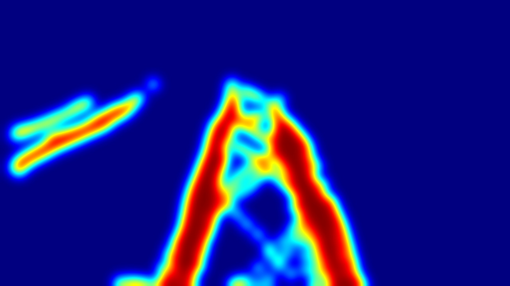

# Interest Heatmap

Приложение для анализа видеоданных и построения тепловых карт зон интереса. Проект предназначен для обработки видеозаписей и видеопотоков, анализа перемещения объектов и визуализации областей, в которых наблюдается наибольшая активность.

## Возможности

- Обработка видео с помощью OpenCV.
- Работа с локальными видеофайлами и RTSP-видеопотоками.
- Обнаружение и отслеживание объектов.
- Построение тепловых карт активности.
- Определение и анализ зон интереса.
- Интеграция с Vision API через CometAPI.
- Экспорт результатов анализа.
- Автоматизированное тестирование с помощью `pytest`.

## Демонстрация работы

В этом разделе представлены результаты работы Interest Heatmap: исходное изображение до обработки, результат анализа и видеодемонстрация приложения.

Программа обрабатывает видеоданные, обнаруживает объекты и визуализирует области активности. Сравнение исходного и обработанного изображения позволяет оценить результат анализа и наглядно увидеть изменения после обработки.

### До анализа

Исходное изображение до применения алгоритмов обнаружения объектов и построения тепловой карты.


### После анализа

Результат обработки с визуализацией, сформированной приложением.



### Видеодемонстрация

Видеоролик демонстрирует работу приложения и процесс обработки видеоданных.

[Посмотреть демонстрацию работы приложения](resources/forDocs/DemoProga.MOV)


## Технологии

- **Python 3.10+** — основной язык разработки.
- **OpenCV** — обработка видео и изображений.
- **YOLO** — обнаружение объектов.
- **NumPy** — обработка массивов и вычисления.
- **pytest** — тестирование.
- **CometAPI** — доступ к моделям компьютерного зрения.

## Требования

Перед началом работы установи:

- Python 3.10 или новее.
- Git.
- Зависимости проекта из `requirements.txt`.
- API-ключ CometAPI — если используемые функции Vision API включены в сценарий запуска.

## Установка

### 1. Клонирование репозитория

```bash
git clone https://github.com/Lox0rd/cv-heatmap-analyzer.git
cd cv-heatmap-analyzer
```

### 2. Создание виртуального окружения

```bash
python -m venv .venv
```

### 3. Активация окружения

**Linux / macOS**

```bash
source .venv/bin/activate
```

**Windows (PowerShell)**

```powershell
.venv\Scripts\Activate.ps1
```

### 4. Установка зависимостей

```bash
python -m pip install --upgrade pip
pip install -r requirements.txt
```

## Настройка

Если для работы приложения требуется CometAPI, создай файл `.env` в корневой директории проекта:

```env
COMET_API_KEY=your_api_key_here
COMET_BASE_URL=https://api.cometapi.com/v1
VISION_MODEL=qwen-vl-plus
```

Замени `your_api_key_here` на собственный API-ключ.

**Безопасность:**
- Не добавляй `.env` в Git.
- Не публикуй API-ключ в исходном коде, логах и коммитах.
- Используй `.env.example` для хранения примера конфигурации без секретных данных.

Пример `.env.example`:

```env
COMET_API_KEY=
COMET_BASE_URL=https://api.cometapi.com/v1
VISION_MODEL=qwen-vl-plus
```

## Запуск

Активируй виртуальное окружение и выполни:

```bash
python main.py
```

По умолчанию входные видео размещаются в директории:

```text
data/input/
```

Результаты обработки сохраняются в:

```text
data/output/
```

Убедись, что эти пути соответствуют текущей реализации приложения.

## Тестирование

Для запуска тестов используй:

```bash
pytest
```

Для получения отчёта о покрытии кода, если установлен `pytest-cov`:

```bash
pytest --cov=src --cov-report=term-missing
```

## Структура проекта

```text
cv-heatmap-analyzer/
├── main.py
├── src/
│   ├── config/       # Конфигурация приложения
│   ├── detection/    # Обнаружение и отслеживание объектов
│   ├── video/       # Обработка видео и потоков
│   ├── heatmap/     # Построение тепловых карт
│   ├── zones/       # Работа с зонами интереса
│   ├── analysis/    # Анализ результатов
│   ├── ai/           # Интеграция с Vision API
│   ├── export/       # Экспорт результатов
│   └── gui/          # Графический интерфейс
├── models/           # Файлы моделей
├── data/
│   ├── input/        # Входные данные
│   └── output/       # Результаты обработки
├── tests/            # Автоматизированные тесты
├── requirements.txt  # Зависимости Python
├── .env.example      # Пример конфигурации
└── .gitignore
```

Структура приведена как ориентир: названия директорий и наличие файлов должны соответствовать реальному состоянию репозитория.

## Планы развития

- Улучшение точности обнаружения и отслеживания объектов.
- Развитие анализа зон интереса.
- Улучшение визуализации результатов.
- Расширение автоматизированных тестов.
- Развитие обработки видеопотоков и устойчивости к временным сбоям соединения.

## Лицензия

Лицензия проекта пока не указана. Перед распространением кода выбери подходящую лицензию и добавь файл `LICENSE` в корень репозитория.